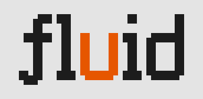

<p align="center">
  <a href="https://github.com/unaquatic/fluid">
    <picture>
      <source media="(prefers-color-scheme: dark)" srcset="docs/logo-dark.svg">
      
    </picture>
  </a>
</p>

<p align="center">
  <a href="https://go.dev/"></a>
  <a href="https://github.com/unaquatic/fluid/blob/main/LICENSE"></a>
</p>

<p align="center"><b>A terminal user interface framework written in golang.</b></p>

---

## Install

```sh
go get github.com/unaquatic/fluid
```

## Usage

```go
package main

import (
	"context"
	"log"

	"github.com/unaquatic/fluid/layout"
	"github.com/unaquatic/fluid/style"
	"github.com/unaquatic/fluid/terminal"
	"github.com/unaquatic/fluid/widget"
)

func main() {
	r, err := terminal.NewRenderer(terminal.Config{
		InlineMode: true,
	})
	if err != nil {
		log.Fatal(err)
	}

	r.Root().Add(widget.NewBox(
		widget.BoxWithLayout(layout.WithFlexDirection(layout.DirectionColumn)),
		widget.BoxWithBorder(style.BorderAll()),
		widget.BoxWithBorderStyle(style.BorderSingle),
		widget.Children(
			widget.NewText("hello, fluid"),
		),
	))

	if err := r.Run(context.Background()); err != nil {
		log.Fatal(err)
	}
}
```

## Colors

The renderer picks 24-bit, 256, or 16 colors from the environment, and maps every color to the nearest one the terminal can show:

- 24-bit when `COLORTERM` is `truecolor` or `24bit`, or `TERM` ends in `-direct`.
- 256 inside tmux or screen, unless `COLORTERM` advertises 24-bit.
- 24-bit for known terminals, such as Ghostty, iTerm2, WezTerm, Kitty, and VS Code.
- 256 when `TERM` contains `256color`, and 16 when `TERM` is empty or `dumb`.
- 24-bit for any other terminal.

Set `FLUID_COLOR` to `truecolor`, `24bit`, `256`, or `16` to choose one yourself.

## Commands

```sh
go run github.com/unaquatic/fluid/cmd/fluid demo markdown          # run a demo; fluid -h lists all 13
go run github.com/unaquatic/fluid/cmd/design -root .               # paint golden frames files in the browser
go run github.com/unaquatic/fluid/cmd/goldenview -o goldens.html . # draw every golden frames file in color
```

- `fluid demo <name>` runs an interactive demo of the widgets, the layout engine, or the inline and fullscreen modes, with `-no-mouse`.
- `design` serves an editor on port 4098 that paints the golden frames and sequence files under `-root` cell by cell and saves them as `testutil` writes them; `design ansi file...` prints them with ANSI escape sequences.
- `goldenview` writes an HTML page that draws the golden frames files under the given directories in their colors.

## Testing

```sh
go test ./...                  # all tests
go test ./widget/ -v           # widget tests
go test ./render/ -run Inline  # inline render tests
go test ./layout/              # layout engine tests
```

## License

Fluid is released under the [MIT License](LICENSE).
